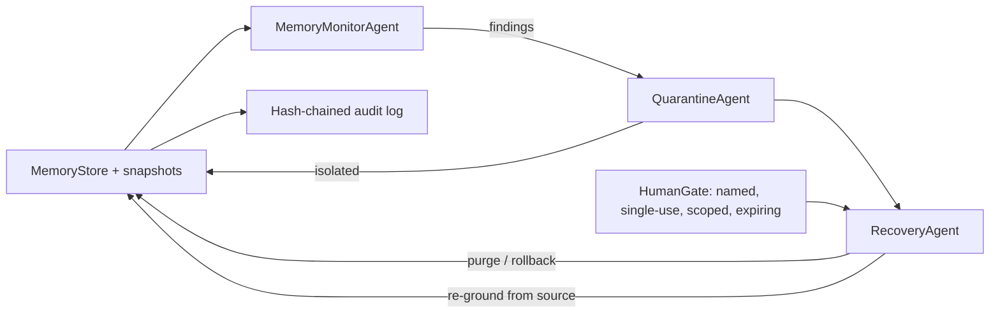

# Jagadish-agent-memory-defense

**Problem:** an agent's memory can go wrong in ways that look like good
answers — planted entries, silent drift, bloated context, citations to
sources that do not exist, contradictory facts, and stale cached values.

**Approach:** a failure taxonomy for agent memory itself, with three
agents that detect, quarantine, and recover, plus a human gate on every
destructive step and a hash-chained audit on every mutation.

**Proof:** 61 tests pass locally (system Python 3.12, pytest 9.1.1,
stdlib only). The demo scenario detects 1 poisoned entry and 1
conflict, quarantines 2 entries, rolls back 3 entries to a known-good
snapshot, and verifies the memory clean afterward (0 post-scan
findings, audit chain valid).

> **Disclaimer:** this is an independent study project. It is not
> affiliated with, endorsed by, or connected to any real company.
> The demo operator "Zelvermere Systems" is fictional, and all data is
> synthetic. Nothing here uses real customer data or live model calls.

## Purpose and who it is for

For builders of agent systems who need memory to be trustworthy: if an
agent remembers things across turns, that memory needs the same
treatment as any other data store — failure modes, detection, isolation,
recovery, and an audit trail. This repo demonstrates that loop on
synthetic data.

## The failure taxonomy

| Class | Meaning | Detection |
|---|---|---|
| `poisoned` | Entry planted/altered by an untrusted source to steer later answers | Injection phrases; untrusted source + override-style directive |
| `drift` | Content changed materially without an approved change record | Token similarity vs baseline below 0.5, unapproved |
| `context_stuffing` | Bloated or filler-dominated entry crowding out useful context | Token count over 200, or majority filler words |
| `retrieval_hallucination` | Retrieval cites a source that does not exist in the store | Cited id not in the store |
| `conflict` | Two active entries under one key with incompatible values | Same key, differing normalized content |
| `cache_staleness` | Entry older than its TTL, or behind the latest source version | Age over TTL (default 10 steps) or version lag |

## Architecture



See `knowledge/architecture-diagram.md` for the full diagram and
`docs/architecture.md` for the design notes.

## How it works, step by step

1. **Seed and snapshot.** Good entries are added and a snapshot
   (`snap-good`) is taken as the known-good state.
2. **Detect.** `MemoryMonitorAgent.scan()` runs every taxonomy detector
   plus conflict and hallucination checks.
3. **Triage and quarantine.** Poisoned, drifted, and conflicting entries
   are isolated by `QuarantineAgent`, so they cannot be retrieved.
4. **Recover, gated.** `RecoveryAgent` can purge or roll back — but only
   with a human approval that is named-person, single-use, scoped to
   that exact action, and expiring. Re-grounding from a trusted source
   is non-destructive and needs no gate.
5. **Verify clean.** A follow-up scan must find nothing and the audit
   chain must verify; otherwise the run is not reported clean.

## Real code and real output

```python
from agent_memory_defense import Approval, build_demo_store, run_cycle

store, baselines, snapshot_id = build_demo_store()
approval = Approval(approver="Priya Nair", token="demo-1",
                    scope=f"rollback:{snapshot_id}", expires_step=10,
                    confidence=1.0, consent_text="yes")
metrics = run_cycle(store, baselines, rollback_approval=approval,
                    snapshot_id=snapshot_id)
```

Real output from `scripts/demo_report.py`:

```
demo metrics:
  findings: 2
  by_class: {'poisoned': 1, 'conflict': 1}
  quarantined: ['e-9', 'e-1']
  rolled_back: ['e-1', 'e-2', 'e-3']
  post_scan_findings: 0
  audit_valid: True
  clean: True
  active entries after recovery: 3
  quarantined entries after recovery: 1
```

Note the demo's poisoned entry shares its key with the good refund
policy, so the monitor also reports a conflict; both entries are
quarantined, then rollback restores the three good entries.

## How to run

```bash
PYTHONPATH=src python -m pytest tests
python scripts/count_tests.py        # prints the real test total
PYTHONPATH=src python scripts/demo_report.py
```

Stdlib only, offline. No virtualenv is created inside the repo; tests
run with the system Python.

## Guardrails and security controls

- **Human gate on destructive recovery.** Purge and rollback require a
  named-person, single-use, scoped, expiring approval. Tested denial
  paths: bypass (no approval), reject, absent (unknown token), expired,
  low-confidence, self-contradicting consent ("yes, wait, no"), scope
  mismatch, and single-use reuse.
- **Hash-chained audit.** Every mutation appends a SHA-256-chained
  record; tampering breaks `verify()`. Tested.
- **PII redaction.** Audit details and content pass through redaction
  covering phone numbers, SSNs, **card numbers**, and **email
  addresses** — not just phone/SSN.
- **Budget inputs reject negatives.** Cost and budget validation raise
  on negative values.
- **Brand check.** The blocklist is stored as SHA-256 hashes, never
  plain names, and a test asserts it is non-empty.
- **Synthetic data only.** No real company names, no real customer
  data, no live credentials.

## Limitations and known failures

- Detectors are deterministic heuristics on synthetic text (phrase
  lists, token similarity, counts), not a trained classifier; they will
  miss subtle paraphrases and can flag borderline phrasing.
- Thresholds (similarity 0.5, stuffing 200 tokens, TTL 10 steps) are
  documented constants, not tuned values.
- Rollback restores snapshot entries but does not delete entries
  created after the snapshot; those stay quarantined until a gated
  purge removes them.
- The brand blocklist ships with synthetic placeholder hashes; a
  deployment must supply its own.
- CI is included but **not verified** (see status table).

## Built / Written-not-run / Planned

| Item | Status |
|---|---|
| Six-class failure taxonomy + detectors | Built, 61 tests green locally |
| Monitor, quarantine, recovery agents | Built |
| Human gate (all denial paths tested) | Built |
| Hash-chained audit, PII redaction, budget + brand checks | Built |
| Demo scenario (poisoned -> quarantine -> rollback -> clean) | Built, numbers above |
| CI workflow (`.github/workflows/ci.yml`) | Written, not run — CI NOT verified |
| CodeQL, Dependabot, branch rulesets, profile README update | Planned (repo-creation time) |
| 8-word overlap check against source material | Not run — prose here is original; no source text was copied |
| Deployment | Not planned; offline study project |

## Docs

- `knowledge/notes.md` — distilled notes on the taxonomy and design.
- `knowledge/architecture-diagram.md` — Mermaid architecture diagrams.
- `docs/architecture.md`, `docs/implementation-guide.md`,
  `docs/threat-model.md`, `docs/interview-points.md`,
  `docs/adr/` — design, adoption, threat model, and decisions.
